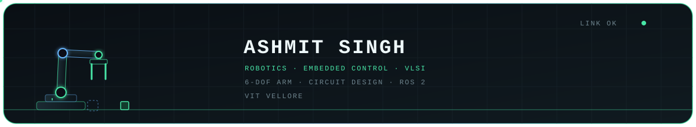

  

  <strong>Robotic Arms • Embedded Control • VLSI Design &amp; Test</strong> 
  Connecting Mechanics, Electronics and Firmware, from Motor Drivers to RTL.

  
  

  <a href="https://linkedin.com/in/ashmitsingh7">LinkedIn</a>
  &nbsp;·&nbsp;
  <a href="mailto:ashmitsingh719@gmail.com">Email</a>
  &nbsp;·&nbsp;
  <a href="https://github.com/ashmitsingh7?tab=repositories">Repositories</a>

  Open to Robotics, Embedded and VLSI roles and collaborations.

